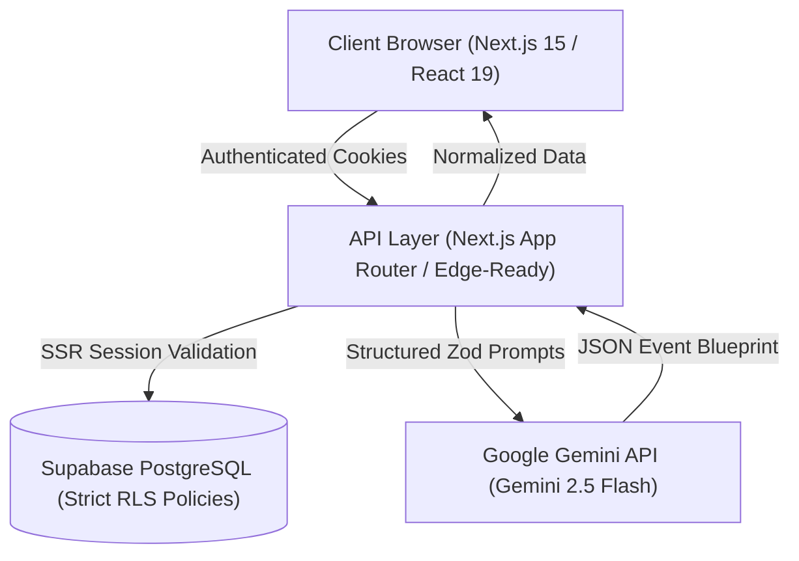

# EventPilot AI

> **Plan smarter. Celebrate better.**

EventPilot AI is a production-grade, full-stack GenAI celebration and event planning application developed for **Prompt Wars Challenge 5 — Celebration & Event Planner**. It pairs Google Gemini 2.5 generative intelligence with deterministic financial arithmetic, real-time interactive workspaces, and persistent Supabase PostgreSQL cloud storage with strict Row Level Security (RLS).

---

## 🌟 Key Features

### 1. 🤖 Gemini AI Planning Engine
- **Bespoke Blueprint Synthesis**: Formulates tailored celebration packages based on event type, guest count, budget, currency, aesthetic theme, dietary restrictions, and accessibility constraints.
- **Run-of-Show Itinerary**: Structured hourly milestones from vendor arrival to post-event teardown.
- **Risk Register & Assumptions**: Identifies potential logistical pitfalls and formulates concrete contingency recommendations.
- **Deterministic Math Guardrails**: AI never performs exact financial calculations; all allocations are normalized and validated server-side.

### 2. 💰 Smart Budget Workspace
- **Cent-Precision Accounting**: Full prevention of floating-point drift using safe integer-cents arithmetic.
- **Contingency Reserve Isolation**: Clearly distinguishes allocated contingency reserves from unallocated capital.
- **Real-Time Visual Breakdown**: Interactive category charts with automatic overspending warnings.
- **Inline Editing & Currency Formatting**: Instant inline price adjustments with locale-compliant formatting (USD `$`, INR `₹`, EUR `€`, GBP `£`, etc.).

### 3. ✅ Interactive Task Checklist
- **Deadline Urgency Engine**: Categorizes tasks into `overdue`, `urgent` (within 7 days), and `upcoming`.
- **Dynamic Event Date Shifts**: Recalculates all date-relative task deadlines deterministically whenever the event date moves.
- **Priority & Status Filters**: Instant filtering across priorities (`high`, `medium`, `low`) and statuses (`todo`, `in_progress`, `completed`).

### 4. 📅 Dynamic Timeline Workspace
- **Live Day Countdown**: Timezone-aware event-day countdown timer.
- **Synchronized Milestones**: Visual representation of deadlines mapped against the hourly run-of-show schedule.

### 5. 💬 AI Copilot Workspace Assistant
- **Conversational Iterations**: Natural language modifications such as *"Reduce budget by ₹5,000 without sacrificing food quality"* or *"Make this celebration child-friendly"*.
- **Structured Change Proposals**: Formulates transparent before-and-after comparisons with explicit trade-off explanations.
- **Human-in-the-Loop Approval**: User reviews and approves material changes before anything is written to the database.
- **Security Sandboxing**: AI output cannot execute arbitrary code, modify system columns, or alter unpermitted fields.

### 6. 🤝 Vendor Management & Quote Extraction
- **Quotation Extraction**: Paste or input vendor quotation sheets; Gemini extracts itemized inclusions, exclusions, quoted totals, and validity dates with confidence warnings.
- **Side-by-Side Comparison**: Compare shortlisted vendors per category to make informed hiring decisions.

---

## 🏗️ Architecture & Technology Stack



| Layer | Technology | Purpose |
| :--- | :--- | :--- |
| **Framework** | Next.js 15.5 (App Router) | High-performance React framework with React 19 server/client components |
| **Language** | TypeScript (Strict Mode) | End-to-end type safety across domain models and API contracts |
| **Styling** | Tailwind CSS | Modern, accessible, responsive design system |
| **Icons** | Lucide React | Consistent iconography across workspaces |
| **Persistence** | Supabase (PostgreSQL 15) | Relational cloud database with Row Level Security (RLS) |
| **Auth** | Supabase Auth (@supabase/ssr) | Secure cookie-based authentication with automatic session refresh |
| **AI Engine** | Google Gemini API (gemini-2.5-flash)| Bespoke celebration blueprints, copilot revisions, and quote extraction |
| **Hosting & CI/CD** | Vercel & GitHub | Continuous deployment pipeline with production previews |

---

## 🚀 Getting Started Locally

### Prerequisites
- Node.js `v20+` or `v24+` (verified on `v24.14.1`)
- npm `v10+`
- Git

### 1. Clone the repository
```bash
git clone https://github.com/manansharma1411/EventPilotAi.git
cd EventPilotAi
```

### 2. Install dependencies
```bash
npm install
```

### 3. Configure environment variables
Create a `.env.local` file in the root directory:
```bash
cp .env.example .env.local
```

Populate the following variables:
```env
NEXT_PUBLIC_SUPABASE_URL=https://<your-project-id>.supabase.co
NEXT_PUBLIC_SUPABASE_PUBLISHABLE_KEY=sb_publishable_<your-key>
GEMINI_API_KEY=<your-google-gemini-api-key>
```
*(Note: Ensure `NEXT_PUBLIC_SUPABASE_URL` does NOT include `/rest/v1/` at the end).*

### 4. Run database migrations
Apply the schema in your Supabase SQL Editor:
- Open `supabase/migrations/20261022000001_eventpilot_core_schema.sql` and run it in the Supabase Dashboard SQL Editor.

### 5. Start development server
```bash
npm run dev
```
Open [http://localhost:3000](http://localhost:3000) to start planning events.

---

## 🧪 Testing & Quality Assurance

EventPilot AI includes a comprehensive automated test suite with 26 automated unit and integration tests across all core systems:

```bash
# Run TypeScript strict type verification
npx tsc --noEmit

# Run ESLint validation
npm run lint

# Run the automated QA test suite
npm run test

# Run production Next.js build
npm run build
```

### Test Coverage Highlights (31 Automated Tests):
- **Event Validation Suite**: Valid payloads, empty titles, unauthorized types, malformed dates, zero guest counts.
- **AI Planning Engine Suite**: Valid plan schema parsing, corrupt JSON handling, missing field rejection, timeout error masking, HTTP 429 rate limit backoff.
- **Financial & Timeline Suite**: Exact cent arithmetic, zero budget edge cases, full allocation math, overspending detection, contingency separation, negative number clamping, deadline urgency analysis, event date shifting offsets, timezone boundaries, currency formatting.
- **Copilot & Vendor Suite**: Change proposal schema validation, privileged field stripping, infeasible request handling, quotation extraction confidence checks.
- **Database RLS & Security Suite**: Cross-user data isolation, state machine constraint enforcement, XSS input sanitization, vendor selection lifecycle, bounded quotation buffer safety.

---

## 🔒 Security & Data Protection

1. **Zero Key Exposure**: `GEMINI_API_KEY` is restricted strictly to server-side routes and is never sent to the browser or client bundles.
2. **Database Row Level Security (RLS)**: Every database table (`events`, `tasks`, `budget_items`, `event_vendors`, `plan_versions`) enforces ownership via `auth.uid() = user_id`.
3. **Server-Side Authorization**: API routes authenticate requests via server-side session cookies and independently verify event ownership before executing any database mutation.
4. **Input Sanitization**: Freeform user text and quotation inputs are bounded (max 20,000 characters) to prevent buffer overflows and excessive token consumption.
5. **No Dangerous HTML**: All user and AI content is rendered safely via React JSX escaping without `dangerouslySetInnerHTML`.

---

## 🎬 Demo Video Storyboard (User Journey)

| Time | Scene | Action & Narration |
| :--- | :--- | :--- |
| **0:00 - 0:15** | **Landing Page** | Introduce EventPilot AI: *"Plan smarter. Celebrate better."* Show responsive hero section, feature cards, and instant sign-in. |
| **0:15 - 0:45** | **Event Creation Wizard** | Create an event (*e.g., Golden 50th Anniversary Gala, 120 guests, budget ₹75,000, theme "Mid-Century Elegance"*). |
| **0:45 - 1:15** | **AI Event Architect** | Click *Generate AI Blueprint*. Gemini creates custom color palettes, run-of-show schedule, per-guest budget allocations, and contingency risks. |
| **1:15 - 1:45** | **Smart Budget & Tasks** | Demonstrate inline budget editing. Show automatic warning when an item causes overspending. Complete a checklist task and show progress bar update. |
| **1:45 - 2:15** | **AI Copilot Revision** | Ask Copilot: *"Adjust the catering budget down by ₹5,000 and reallocate to live acoustic music."* Review before-and-after proposal and click *Apply*. |
| **2:15 - 2:45** | **Vendor Quotation Extraction**| Paste an unorganized vendor quote into the extractor. Watch it extract line items, quoted totals, and validity terms with confidence flags. |
| **2:45 - 3:00** | **Persistence & Security** | Refresh browser (`F5`) to verify data persistence in Supabase PostgreSQL. Conclude demo. |

---

## ⚠️ Known External Limitations

1. **Free Tier AI Quotas**: Free-tier Gemini API keys are subject to Google's rate limits (15 requests/minute). EventPilot AI incorporates exponential backoff and helpful UI alerts when limits are approached.
2. **Third-Party Email Confirmation**: If Supabase project settings have *"Confirm email"* enabled in Auth, users must click the verification link sent to their email before signing in.
3. **Live Vendor APIs**: Real-time live inventory queries require commercial vendor aggregator APIs; EventPilot AI provides manual entry, demo catalog templates, and AI-powered quotation extraction.
